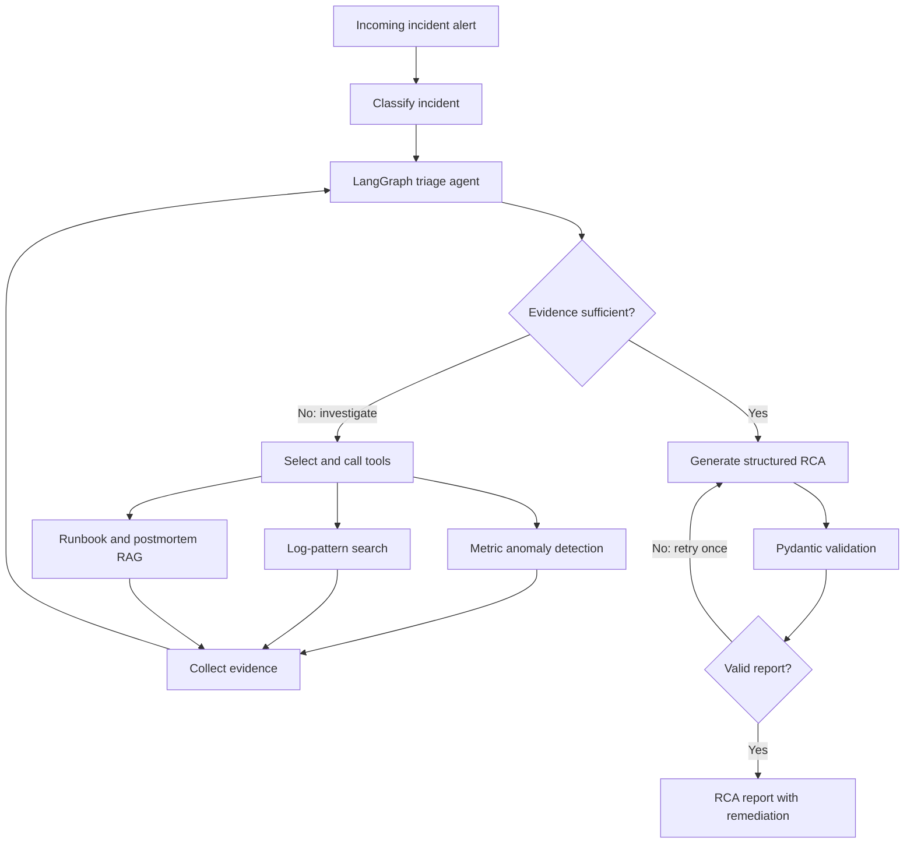

# Havoc: Agentic Incident Triage and Root-Cause Analysis

Havoc is an agentic incident-triage assistant that investigates synthetic production incidents using telemetry analysis, log-pattern search, and retrieval-augmented generation (RAG) over runbooks and postmortems. It produces structured root-cause analysis (RCA) reports with suggested remediation.

## Architecture

## Architecture

The following diagram shows the incident-triage workflow, evidence-gathering tools, and RCA validation loop.



## Technology Stack

- **Agent orchestration:** LangGraph
- **LLM:** Google Gemini (`gemini-3.1-flash-lite`)
- **Retrieval:** FAISS, LangChain, sentence-transformers
- **Embeddings:** `sentence-transformers/all-MiniLM-L6-v2`
- **Anomaly detection:** Robust z-score and Isolation Forest
- **API:** FastAPI
- **Validation:** Pydantic
- **Testing and packaging:** pytest, Docker, GitHub Actions

## Setup

Python 3.11 or newer is recommended.

Create and activate a virtual environment, then install the dependencies:

```bash
python -m venv .venv
```

On Windows PowerShell:

```powershell
.venv\Scripts\Activate.ps1
```

On Linux or macOS:

```bash
source .venv/bin/activate
```

Install the project and embedding dependencies:

```bash
pip install -r requirements-dev.txt -r requirements-hf.txt
pip install -e .
```

Create a local environment file from the example:

```bash
# Windows PowerShell
Copy-Item .env.example .env

# Linux or macOS
cp .env.example .env
```

Add your Google AI Studio API key to `.env`:

```dotenv
GOOGLE_API_KEY=your_google_api_key_here
GEMINI_MODEL=gemini-3.1-flash-lite
```

Never commit `.env` or publish your API key.

## Generate Data and Build the Index

The project uses synthetic incidents, telemetry, runbooks, and postmortems.

```bash
python scripts/generate_data.py
python scripts/build_index.py
```

## Run the API

```bash
uvicorn havoc.api:app --reload
```

Open `http://127.0.0.1:8000/docs` to explore the API. The triage endpoint accepts an incident ID, such as `INC-001`.

## Tests

```bash
python -m pytest
```

## Evaluation

Run retrieval and anomaly-detection evaluation without LLM calls:

```bash
python scripts/evaluate.py --skip-llm
```

Evaluate the three RCA variants:

```bash
python scripts/evaluate.py --variants baseline,agent_no_rag,agent --sleep 3
```

The variants are:

- **Baseline:** Plain LLM using alert text.
- **Agent without RAG:** Tool-using agent without runbook retrieval.
- **Full agent:** Tool-using agent with runbook retrieval.

Evaluation outputs are written to `results/results.json` and `results/results.md`. RCA results should be reported with the model name, number of incidents, successful predictions, accuracy, and 95% confidence intervals. Failed predictions must be reported separately.

## Current Retrieval and Anomaly Results

These preliminary results use **30 synthetic incidents**.

### Retrieval

| Query                   |                      Hit@1 |                      Hit@3 |
| ----------------------- | -------------------------: | -------------------------: |
| Alert text only         |   5/30 (17%; 95% CI 7–34%) | 10/30 (33%; 95% CI 19–51%) |
| Alert plus log evidence | 16/30 (53%; 95% CI 36–70%) | 26/30 (87%; 95% CI 70–95%) |

### Anomaly Onset Detection

Success means detecting onset within 15 minutes of the true onset.

| Method           |                     Detected |
| ---------------- | ---------------------------: |
| Robust z-score   | 30/30 (100%; 95% CI 89–100%) |
| Isolation Forest |   19/30 (63%; 95% CI 46–78%) |

RCA accuracy results for the baseline, agent without RAG, and full agent should be taken from the completed LLM evaluation in `results/results.md`, not inferred from retrieval or anomaly-detection metrics.

## Limitations

- All incidents and supporting runbooks are synthetic.
- The evaluation set is small; confidence intervals reflect substantial uncertainty.
- Synthetic runbooks may be easier to retrieve than real operational documentation.
- Telemetry is read from local files rather than production observability systems such as Prometheus or Loki.
- Model outputs and confidence scores should not be treated as calibrated probabilities without separate validation.

## License

No license has been added yet. Until a license is chosen, assume the default copyright restrictions apply.
