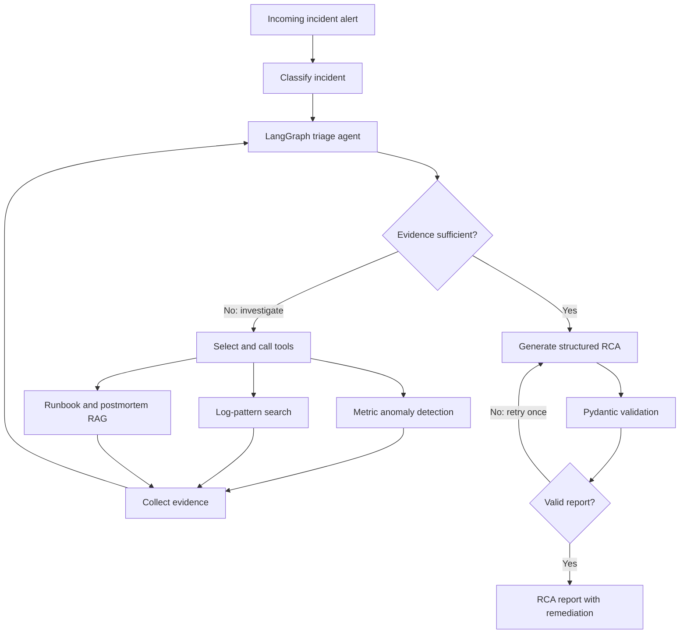

# Havoc: Agentic Incident Triage and Root-Cause Analysis

Havoc is an agentic incident-triage assistant that investigates synthetic production incidents using telemetry analysis, log-pattern search, and retrieval-augmented generation (RAG) over runbooks and postmortems. It produces structured root-cause analysis (RCA) reports with suggested remediation.

## Architecture

The following diagram illustrates the incident-triage workflow, evidence-gathering tools, and RCA validation loop.



## Technology Stack

- **Agent orchestration:** LangGraph
- **LLM:** Google Gemini (`gemini-3.1-flash-lite`)
- **Retrieval:** FAISS, LangChain, sentence-transformers
- **Embeddings:** `sentence-transformers/all-MiniLM-L6-v2`
- **Anomaly detection:** Robust z-score and Isolation Forest
- **API:** FastAPI
- **Validation:** Pydantic
- **Testing and packaging:** pytest, Docker, GitHub Actions

## Setup

Python 3.11 or newer is recommended.

Create and activate a virtual environment:

```bash
python -m venv .venv
```

On Windows PowerShell:

```powershell
.venv\Scripts\Activate.ps1
```

On Linux or macOS:

```bash
source .venv/bin/activate
```

Install the project and embedding dependencies:

```bash
pip install -r requirements-dev.txt -r requirements-hf.txt
pip install -e .
```

Create a local environment file from the example.

On Windows PowerShell:

```powershell
Copy-Item .env.example .env
```

On Linux or macOS:

```bash
cp .env.example .env
```

Add your Google AI Studio API key to `.env`:

```dotenv
GOOGLE_API_KEY=your_google_api_key_here
GEMINI_MODEL=gemini-3.1-flash-lite
```

Never commit `.env` or publish your API key.

## Generate Data and Build the Index

The project uses synthetic incidents, telemetry, runbooks, and postmortems.

```bash
python scripts/generate_data.py
python scripts/build_index.py
```

## Run the API

```bash
uvicorn havoc.api:app --reload
```

Open [http://127.0.0.1:8000/docs](http://127.0.0.1:8000/docs) to explore the API. The triage endpoint accepts an incident ID, such as `INC-001`.

## Tests

```bash
python -m pytest
```

The project also includes a GitHub Actions workflow that runs tests and builds the Docker image.

## Evaluation

Run retrieval and anomaly-detection evaluation without LLM calls:

```bash
python scripts/evaluate.py --skip-llm
```

Evaluate the three RCA variants:

```bash
python scripts/evaluate.py --variants baseline,agent_no_rag,agent --sleep 3
```

The variants are:

- **Baseline:** Plain LLM using alert text.
- **Agent without RAG:** Tool-using agent without runbook retrieval.
- **Full agent:** Tool-using agent with runbook retrieval.

Evaluation outputs are written to `results/results.json` and `results/results.md`. RCA accuracy, completion rate, tool calls, and latency are reported separately.

## Evaluation Results

All results below are from **30 synthetic incidents** evaluated using Google Gemini 3.1 Flash Lite (`gemini-3.1-flash-lite`). The confidence intervals are 95% Wilson intervals.

### RCA Accuracy

| Variant                    |   Accuracy (95% CI) |    Completed | Failed | Valid RCA | Avg. tool calls | Avg. latency |
| -------------------------- | ------------------: | -----------: | -----: | --------: | --------------: | -----------: |
| Baseline (alert text only) |  30% (9/30, 17–48%) | 30/30 (100%) |      0 |     30/30 |             0.0 |        2.6 s |
| Agent without RAG          | 97% (29/30, 83–99%) | 30/30 (100%) |      0 |     30/30 |             2.0 |       12.1 s |
| Full agent with RAG        | 90% (27/30, 74–97%) | 30/30 (100%) |      0 |     30/30 |             3.0 |       24.7 s |

In this evaluation, both tool-using variants outperformed the alert-only baseline. The full agent with RAG did not improve accuracy over the agent without RAG and had higher average latency. The difference between the two agent variants should not be treated as statistically established from this small sample.

### Retrieval

Retrieval hit@k measures whether the correct cause's runbook or postmortem appears among the top-k retrieved documents.

| Query                   |                      Hit@1 |                      Hit@3 |
| ----------------------- | -------------------------: | -------------------------: |
| Alert text only         |   17% (5/30, 95% CI 7–34%) | 33% (10/30, 95% CI 19–51%) |
| Alert plus log evidence | 53% (16/30, 95% CI 36–70%) | 87% (26/30, 95% CI 70–95%) |

Adding log evidence improved retrieval performance on this synthetic dataset.

### Anomaly Onset Detection

Success means detecting the onset within 15 minutes of the true onset.

| Method           |                     Detected |
| ---------------- | ---------------------------: |
| Robust z-score   | 100% (30/30, 95% CI 89–100%) |
| Isolation Forest |   63% (19/30, 95% CI 46–78%) |

Robust z-score performed better than Isolation Forest on this evaluation set.

## Limitations

- All incidents, telemetry, runbooks, and postmortems are synthetic.
- The evaluation set is small; confidence intervals reflect uncertainty.
- Synthetic runbooks may be easier to retrieve than real operational documentation.
- Telemetry is read from local files rather than production observability systems such as Prometheus or Loki.
- These results measure performance on the current synthetic dataset and do not establish production performance.
- Model-generated confidence scores should not be treated as calibrated probabilities without separate validation.

## License

No license has been added yet. Until a license is chosen, assume the default copyright restrictions apply.
