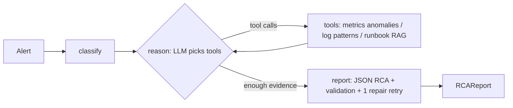

# Havoc: agentic incident triage and root-cause analysis

Give it an alert ("p95 latency 2,640 ms on checkout-service"). A LangGraph agent investigates
with tools (metric anomaly detection, log pattern search, RAG over runbooks and postmortems)
and returns a schema-validated root-cause analysis with suggested remediation.



## Stack
LangGraph (agent), LangChain (loaders, splitter, FAISS store, tools), Hugging Face
`all-MiniLM-L6-v2` embeddings, Groq LLM (tool calling), scikit-learn (robust z-score and
IsolationForest), Pydantic (output schema), FastAPI, Docker, pytest, GitHub Actions.

## Quickstart
```bash
python -m venv .venv && source .venv/bin/activate
pip install -r requirements-dev.txt -r requirements-hf.txt && pip install -e .
cp .env.example .env            # add GROQ_API_KEY
python scripts/generate_data.py # synthetic runbooks, incidents, metrics, logs
pytest
python scripts/build_index.py
uvicorn havoc.api:app --reload   # then POST /triage {"incident_id": "INC-001"}
```

## Evaluation
`python scripts/evaluate.py --variants baseline,agent_no_rag,agent --sleep 3`

| Variant | RCA accuracy | Valid JSON | Avg tool calls |
|---|---|---|---|
| plain LLM (alert text only) | TODO | TODO | 0 |
| agent without RAG | TODO | TODO | TODO |
| agent (full) | TODO | TODO | TODO |

Paste the table from `results/results.md`, including retrieval hit@k and the anomaly detector.

## Limitations (read before trusting the numbers)
- All data is synthetic and was written by the same author as the runbooks, so retrieval is
  easier than in production. n is small, so read the confidence intervals.
- The baseline sees only the alert text; the interesting comparison is agent vs agent without RAG.
- Telemetry is read from files; in production the tools would query Prometheus/Loki.
